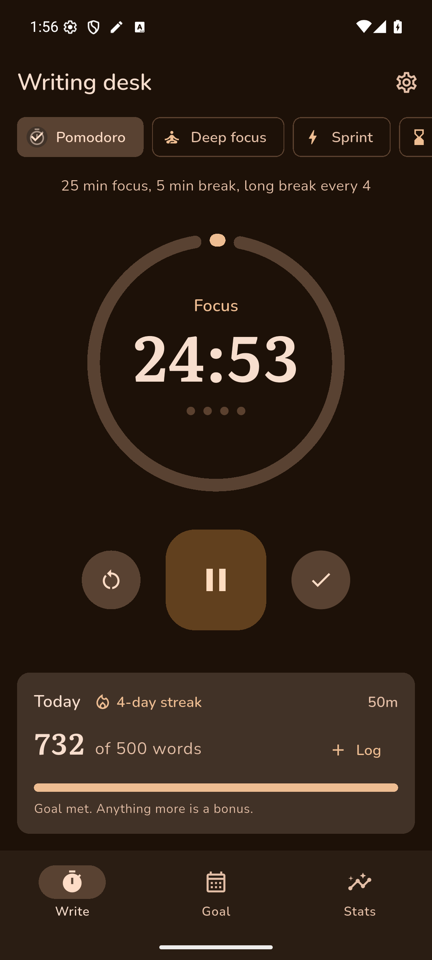
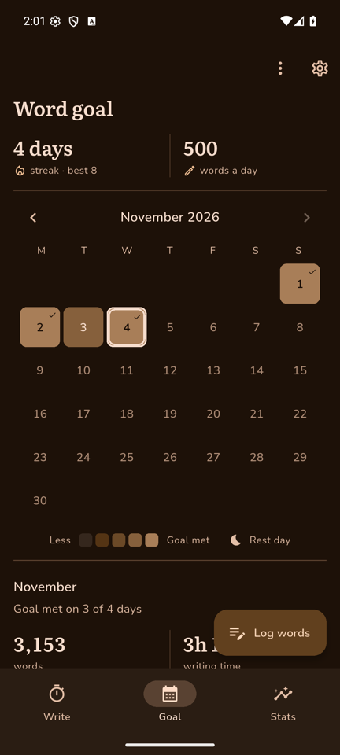
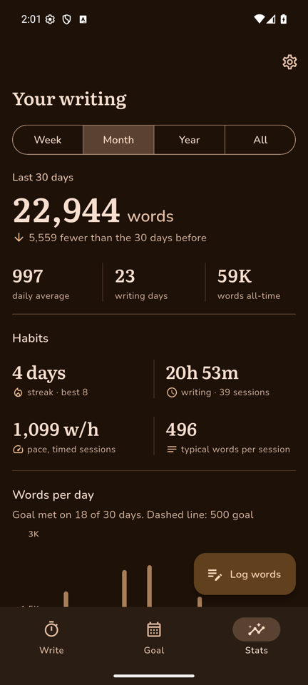
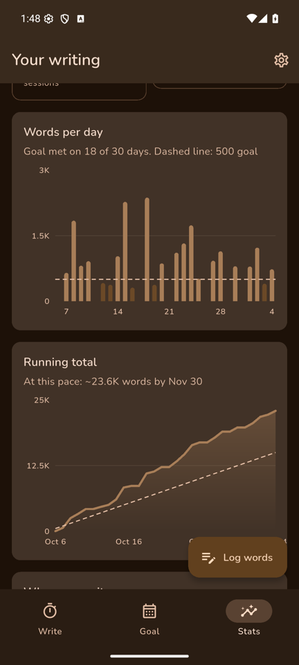

<p align="center">
  
</p>

<h1 align="center">Inkwood</h1>

<p align="center">
  A cozy writing tracker for Android. Time your sessions, keep a daily word goal,<br>
  and watch your progress grow, all in warm shades of brown.
</p>

<p align="center">
  <a href="https://github.com/justsomerandomshit/inkwood/actions/workflows/ci.yml"></a>
  
  
  
  <a href="LICENSE"></a>
</p>

<p align="center">
  
  
  
  
</p>

## Contents

- [Why Inkwood](#why-inkwood)
- [Features](#features)
- [Download](#download)
- [Getting started](#getting-started)
- [How to use it](#how-to-use-it)
- [Design](#design)
- [Project layout](#project-layout)
- [Development](#development)
- [Roadmap](#roadmap)
- [Contributing](#contributing)
- [License and credits](#license-and-credits)

## Why Inkwood

Most writers track three things: how many words they wrote, how long they
wrote for, and whether they're showing up day after day. Inkwood keeps all three in
one quiet place. It doesn't need an account or a connection, and it never nags
you. Everything stays on your phone.

## Features

**Timers for every kind of session**
- **Pomodoro.** 25 minutes of focus, 5-minute breaks, and a long break after every 4 rounds.
- **Deep focus.** 50 minutes of work, then a 10-minute break.
- **Sprint.** A 15-minute word sprint.
- **Countdown.** A plain countdown of any length.
- **Free write.** An open-ended stopwatch.
- **Notifications.** A live countdown sits in your notifications while a timer runs. When time's up you get an alert with a soft wooden chime, even if the app is closed.
- **Logging words.** When a session ends, Inkwood asks how many words you wrote. Type the number, or enter your manuscript's word count before and after and Inkwood works out the difference.

**A monthly word-goal heat map**
- **Your month at a glance.** Every day is shaded by how close you came to your daily goal.
- **Going back.** Swipe or tap the arrows to see previous months.
- **Changing a day.** Tap a day to see its sessions or log words for it. Long-press it to mark the goal as met.
- **Marking a whole month.** You can mark every past day as goal met (handy for writing you did before you installed Inkwood), or mark the days you didn't write as rest days.
- **Starting fresh.** This starts your streak again from today. Your history stays, dimmed. You can also erase the month and start clean.
- **Rest days.** These keep your streak going without counting as writing days.

**Stats that encourage**
- **Your totals.** Total words with a comparison to the period before, time spent writing, pace in words per hour, and words per session.
- **Charts.** Words per day with your goal line, your running total against the goal pace, the hours and weekdays you write best, and which timer gives you your fastest pace.
- **Personal bests and history.** Your best day, best week, longest streak and fastest session, plus a list of recent sessions you can edit or swipe away.
- **Fair averages.** Averages only count the days you wrote, so a rest day never pulls them down.

**Small things that matter**
- **Undo.** Deleting or bulk-changing anything can be undone.
- **Backups.** Copy a backup to the clipboard, and restore it from there.
- **Sample data.** Ten weeks of pretend writing, so you can explore the charts before you have your own.
- **Screen stays on.** The screen stays awake while a timer runs, and you can turn that off.
- **Reduced motion.** Animations are respected or switched off when the system asks for reduced motion.

## Download

Get the latest APK from the
[Releases page](https://github.com/justsomerandomshit/inkwood/releases/latest).
Open it on your phone and allow installing from your browser or file manager
when Android asks. Inkwood needs Android 8.0 or newer.

New versions are published automatically: pushing a version tag such as
`v0.2.0` builds the APK and attaches it to a new release.

## Getting started

### Requirements

- An Android phone or emulator running Android 8.0 (API 26) or newer
- [Flutter](https://docs.flutter.dev/get-started/install) 3.47 or newer, with the Android SDK
- JDK 17

### Install and run

```bash
git clone https://github.com/justsomerandomshit/inkwood.git
cd inkwood
flutter pub get
flutter run            # with a phone plugged in or an emulator open
```

### Build an APK

```bash
flutter build apk --release
# → build/app/outputs/flutter-apk/app-release.apk
```

Published releases are signed with one permanent release key, so each new
version installs over the last and keeps your data. The release workflow reads
that key from the repository secrets `ANDROID_KEYSTORE_BASE64`,
`ANDROID_KEYSTORE_PASSWORD` and `ANDROID_KEY_ALIAS`. To sign local builds with
it too, put an `android/key.properties` file next to the keystore (it's
git-ignored):

```properties
storeFile=/path/to/inkwood-release.jks
storePassword=…
keyAlias=inkwood
keyPassword=…
```

Without that file, local release builds fall back to the debug key.

To publish a new version, bump `version` in `pubspec.yaml`, then push a tag:

```bash
git tag v0.2.0
git push origin v0.2.0   # builds the APK and creates the GitHub Release
```

Every push to `main` also builds a debug APK, and you can download it from
the [Actions](https://github.com/justsomerandomshit/inkwood/actions/workflows/ci.yml) tab.

## How to use it

1. **Pick a timer** on the **Write** tab and press play. The first time,
   Android asks whether Inkwood may send notifications. Allow it so you hear
   the chime.
2. **When the timer ends**, enter how many words you wrote, or press **Save
   time only** if you were editing. Breaks start on their own after that,
   and you can turn this off in Settings.
3. **Set your daily goal** on the **Goal** tab by tapping the goal number. It
   applies to every day of the current month (earlier months keep theirs), and
   each day is shaded by how close you came to it.
4. **Wrote away from the app?** Press **Log words** on any tab, or tap a day
   on the calendar.
5. **See how you're doing** on the **Stats** tab, and switch between week,
   month, year and all time.

## Design

Inkwood is meant to feel like writing in an oak cabin at night.

- **Colour.** Every colour is a shade of brown, and the app only has a dark
  theme. The colour scheme is made the Material 3 way: five tonal palettes
  in the same oak hue go into a `DynamicScheme`. Every role (surfaces,
  containers, text, outlines) is then the tone that Material 3 assigns to it,
  so text keeps the spec's contrast guarantees. Big shapes stay in dark and
  middle browns, and only text and thin accents use light tan, where
  readability needs it. See
  [`lib/theme/palette.dart`](lib/theme/palette.dart).
- **Heat map.** Each step up the scale is a bit lighter than the last, so
  the order of the colours still reads in greyscale and for colour-blind
  readers. Red and green never appear to mean "failed" or "done".
- **Type.** [Nunito](https://fonts.google.com/specimen/Nunito) is used for
  reading and labels because its rounded letters are easy to read.
  [Literata](https://fonts.google.com/specimen/Literata), the calm serif
  Google designed for reading in Play Books, is used for headings and big
  numbers. Both are bundled with the app, so it works offline.
- **Layout.** Nothing is boxed in cards. Each section sits directly on the
  dark background: a title, the content, then a thin divider before the next
  section. Key numbers sit side by side in a row split by thin vertical lines,
  so you can take them in at a glance.
- **Components.** Inkwood uses Flutter's stock Material 3 widgets and keeps
  their default styling: filter chips, segmented buttons, tonal buttons,
  collapsing top app bars, M3 menus and the 2024 progress indicators.
- **Motion.** Animations use Material's own timings and easing curves.
  Screens fade into each other, numbers count up, charts grow from zero and
  calendar days settle into place. All of it switches off when the system
  asks for reduced motion.
- **Charts.** Charts follow data-visualisation advice from Tufte, Few and
  Datawrapper. They use thin, faint gridlines with only three axis labels,
  and labels are never rotated. Large numbers are shortened ("12.4K"), and
  wording compares you only with your own past. A brand-new user sees a
  friendly empty state rather than empty axes.
- **Sound.** The chimes are generated in code, so there are no licensing
  questions. They sound like a soft marimba: a rising C–E–G when a focus
  session ends, and a gentle falling G–E when a break ends.

## Project layout

```
lib/
├── main.dart               App entry: theme, storage, notifications
├── data/
│   ├── writing_store.dart  Sessions, goals, marks, streaks and saving
│   ├── stats.dart          All numbers behind the Stats page
│   ├── timer_controller.dart  Timer logic, accurate even in the background
│   └── notifier.dart       Live countdown and "time's up" notifications
├── models/models.dart      Session, timer kinds, settings
├── screens/                Write, Goal, Stats, Settings and the tab shell
├── theme/                  Brown Material 3 scheme and theme
├── util/format.dart        Number, time and date helpers
└── widgets/                Charts, sheets, sections and number rows
android/app/src/main/res/
├── raw/chime_*.wav         The two chimes
└── drawable/               Launcher icon and status-bar icon
test/                       Unit and widget tests
```

Data is saved on the device with `shared_preferences` as a single JSON
document. The timer works from clock times rather than counting ticks, so
it stays exact while the app is in the background. Its state is also saved,
so a running timer survives Android closing the app.

## Development

```bash
flutter analyze                 # lint
dart format lib test            # format
flutter test                    # unit + widget tests
```

The tests cover:
- streaks, rest days and fresh starts
- goal history
- saving data and round-tripping backups
- the stats maths
- number formatting
- the timer and notification flow (with a fake notifier)
- a smoke test of every page, with and without data

CI runs formatting, analysis, the tests and an APK build on every push and
pull request.

## Roadmap

- [ ] Pause, skip and finish buttons right inside the timer notification
- [ ] A home-screen widget showing today's words and streak
- [ ] Projects, so words can be tracked per manuscript
- [ ] Exporting sessions to CSV
- [ ] A Play Store listing

## Contributing

Issues and pull requests are welcome. Before you open a pull request, please
run `dart format lib test`, `flutter analyze` and `flutter test`, and keep
the design rules above: dark brown only, and stock Material 3 components.

## License and credits

- **Code.** [MIT](LICENSE).
- **Fonts.** Literata and Nunito are licensed under the
  [SIL Open Font License 1.1](assets/fonts). Their licence texts are also
  shown on the in-app licences page.
- **Icons.** The pen icon is Material Icons' "edit" glyph (Apache 2.0).
- **Libraries.** [fl_chart](https://pub.dev/packages/fl_chart) for charts,
  [flutter_local_notifications](https://pub.dev/packages/flutter_local_notifications)
  for notifications, and [animations](https://pub.dev/packages/animations)
  for Material motion.
